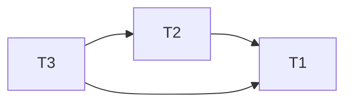
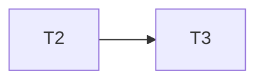
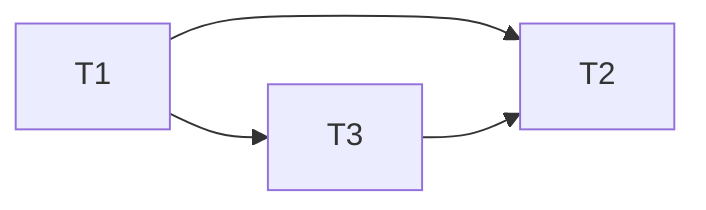
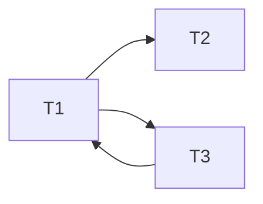

# Exercício da Aula 2

**Aluno:** Victor Jorge Carvalho Chaves
**RA:** 156.740

**1 - Verifique quais das histórias a seguir apresentam *situação de conflito*, identificando os itens confliantes**

**1.e) $H5 = r_3(a) \ w_3(a) \ r_1(a) \ w_1(a) \ r_2(a) \ w_2(a) \ r_2(c) \ c_1 \ c_2 \ c_3$**

| T1   | T2   | T3   |                                                               |
| ---- | ---- | ---- | ------------------------------------------------------------- |
|      |      | r(a) |                                                               |
|      |      | w(a) |                                                               |
| r(a) |      |      | Conflito por conta da escrita $w_3(a)$                        |
| w(a) |      |      |                                                               |
|      | r(a) |      | Conflito por conta da escrita $w_3(a)$  e da escrita $w_1(a)$ |
|      | w(a) |      |                                                               |
|      | r(c) |      |                                                               |
| c    |      |      |                                                               |
|      | c    |      |                                                               |
|      |      | c    |                                                               |

**1.f) $H6 = r_2(a) \ r_2(b) \ w_2(b) \ r_1(a) \ r_1(c) \ w_1(c) \ r_3(a) \ r_3(d) \ w_3(d) \ c_1 \ c_2 \ c_3$**

| T1   | T2   | T3   |               |
| ---- | ---- | ---- | ------------- |
|      | r(a) |      | Sem Conflito! |
|      | r(b) |      | Sem Conflito! |
|      | w(b) |      |               |
| r(a) |      |      | Sem Conflito! |
| r(c) |      |      | Sem Conflito! |
| w(c) |      |      |               |
|      |      | r(a) | Sem Conflito! |
|      |      | r(d) | Sem Conflito! |
|      |      | w(d) |               |
| c    |      |      |               |
|      | c    |      |               |
|      |      | c    |               |

**3 - A partir das histórias listadas a seguir, identifique quais os conjunstos são *equivalentes*** 

**d) H7 = r₃(a) w₃(a) r₂(a) w₂(a) r₁(a) w₁(a) r₃(b) w₃(b) r₁(b) w₁(b) c₁ c₂ c₃  
   H8 = r₃(a) w₃(a) r₃(b) w₃(b) r₂(a) w₂(a) r₁(a) w₁(a) r₁(b) w₁(b) c₁ c₂ c₃**

Resposta: Equivalente, pois:

### **Grafo da H7**

### **Grafo da H8**

**f) H9 =  r₂(a) w₂(a) r₃(a) w₃(a) r₁(l) r₁(a) w₁(a) c₁ c₂ c₃  
   H10 = r₂(a) w₂(a) r₃(a) w₃(a) r₁(m) r₁(a) w₁(a) c₁ c₂ c₃**

### **Grafo da H9**

### **Grafo da H10**

Resposta: Conflito nas operações r₁(l), da H9 e na operaçõa r₁(m) na história H10

---

**4 – A partir das histórias listadas a abaixo, verifique quais delas podem ser consideradas serializáveis, aplicando os passos da Regra da Serializabilidade.**

4.d) $H_4 = r_1(a)\ w_1(a)\ r_2(a)\ r_2(b)\ w_2(b)\ r_3(a)\ w_2(a)\ r_3(l)\ w_3(l)\ r_1(m)\ r_1(p)\ w_1(m)\ c_1\ c_2\ c_3$

É serializavel, pois
    
### **Grafo da H4**

4.e) $H_5 = r_1(a)\ w_1(a)\ r_2(a)\ w_2(a)\ r_2(l)\ r_3(a)\ w_3(a)\ w_3(l)\ w_1(a)\ c_1\ c_2\ c_3$

### **Grafo da H5**

Não é serializavel, pois

